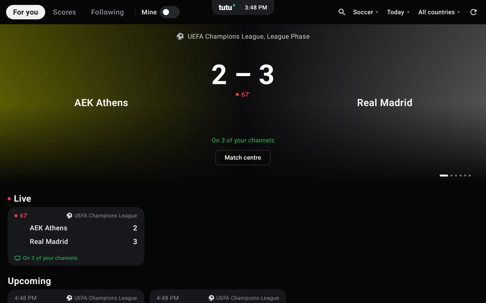
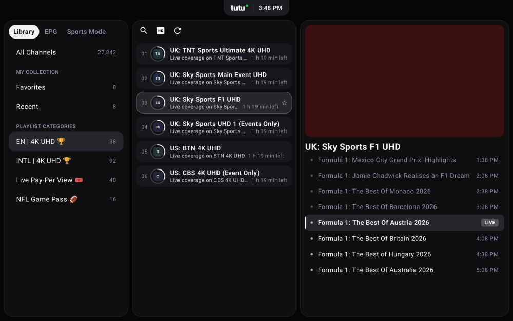
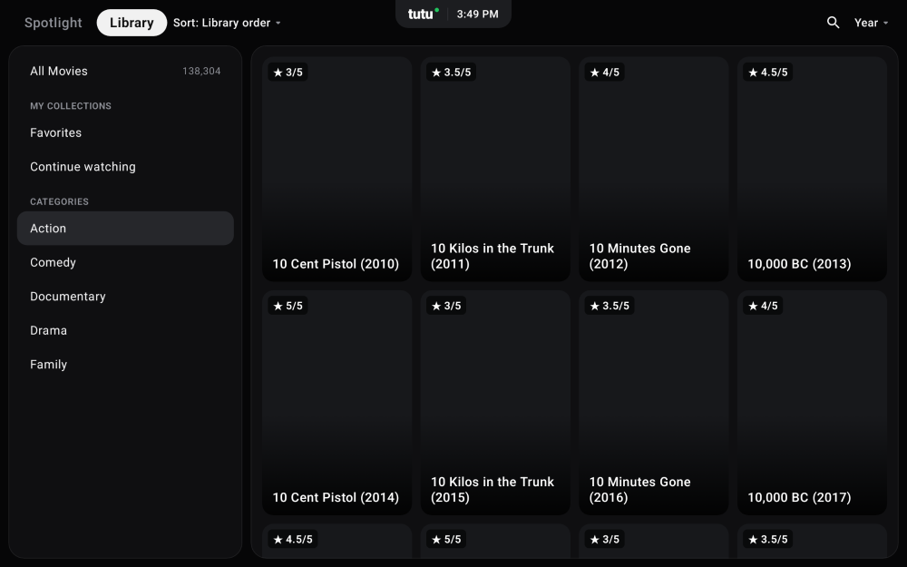
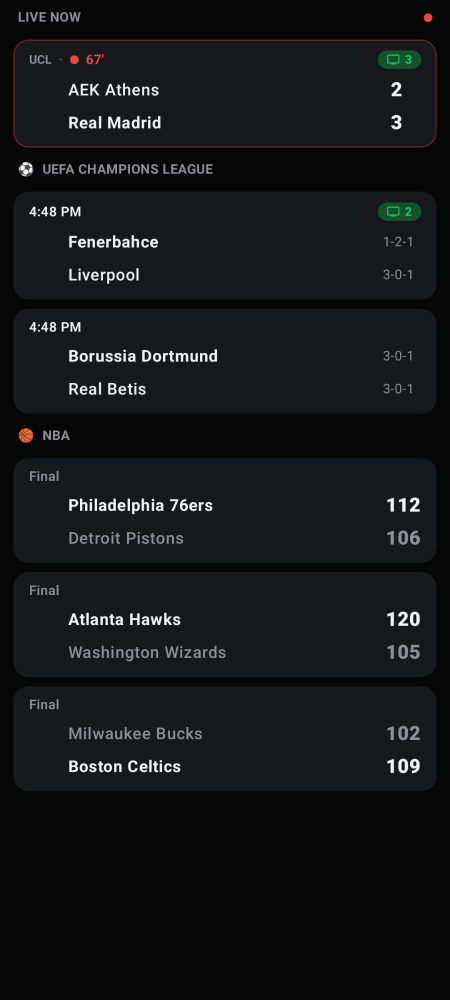
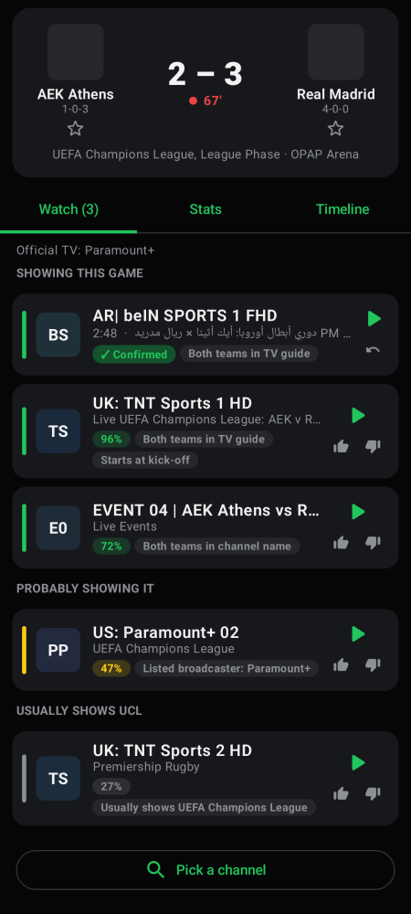
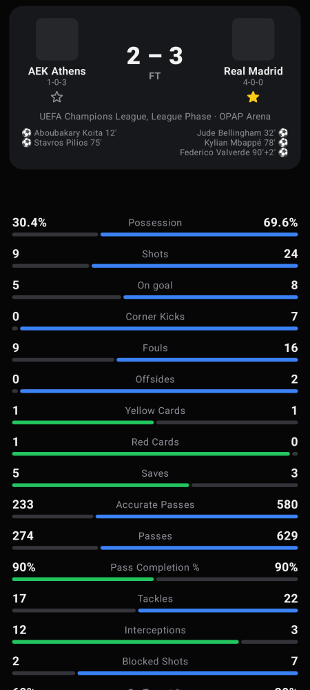

# TuTu

An Android IPTV player built around a **Sports Hub**: live scores and stats for the games on now. Tap a game to see **which of your own channels are showing it**, then tap a channel to watch.

| Sports (tablet/TV) | Live TV library mode | Movies library |
|---|---|---|
|  |  |  |

| Sports Hub (phone) | Where to watch | Stats |
|---|---|---|
|  |  |  |

## Install
Open **Releases** on this repo from your phone or Android TV, download the newest `TuTuTV-v*.apk` and open it
(allow "install unknown apps" when asked).

## Updates
After that you never need to download it by hand again: every change pushed here builds a new release, and the
app offers it the next time it opens ("TuTu 3.6.1 is available" → **Update** → **Install**).
You can also check any time in **Settings → App updates**. Updates keep your playlists and settings.

## Set up
1. **Settings → Your IPTV provider**: enter your Xtream Codes login (server, username, password) or an M3U link.
   Xtream mode is preferred: it's faster and brings the provider's TV guide automatically.
2. Optional: **Where are your channels from?** Pick the regions your channels come from (UK, MENA, US…) so the
   app knows which networks usually show each league.
3. Pick your leagues. Tap ☆ on a team in any game to follow it; its games are pinned to the top.

## How "where to watch" works
For each game, every channel gets a confidence score from:
- **TV guide (EPG):** shows airing at kick-off that mention both teams. Team names are matched in many forms
  ("Man Utd", "Manchester United", "مانشستر يونايتد"), accents and punctuation are ignored, and close
  misspellings still match. Replays, highlights, women's/youth games and "Real Betis" vs "Real (Madrid)" mix-ups are filtered out.
- **Event channels:** provider channels named after the game ("EPL 03: Arsenal vs Chelsea").
- **Broadcasters:** networks ESPN lists for the game (strong), then networks that usually hold the league's rights in your regions (weak hint).
- **Your feedback:** 👍 pins a channel for that game and boosts it for the league next time; 👎 hides it.

Results are grouped as *Showing this game*, *Probably showing it*, and *Usually shows this league*.
"Pick a channel" lets you assign one yourself. Inside the player, swipe up/down to switch between the matched channels.

## What's new in 3.0.0
- Big-screen layout: categories at the far left, a compact channel column, a wide preview + guide pane; the top pill switches sections.
- **Sports Mode** (Scores tab and Live TV): leagues | match with Score / Lineups / Stats / Events / Table | preview + channels showing it.
- More sports: MMA/UFC & PFL (fight cards), tennis (ATP/WTA), golf (PGA, DP World, LPGA leaderboards), F1 & NASCAR sessions, rugby, AFL.
  Boxing isn't in the free scores feed; boxing PPVs still play from your channels.
- Several playlists: show one or combine them all. Add one by scanning a QR code and typing on your phone.
- Hide channel categories you don't use. Choose your sports and follow teams in Settings → My sports & teams.

## Sections
- **Sports:** *For you* (featured-game carousel plus Live / Upcoming / Finished cards), *Scores*, and *Following*.
  The *Mine* switch keeps only games found on your channels. Filter by sport, day and country.
- **Live TV:** *Library mode* (categories · channel cards with progress rings · live preview with the channel's schedule),
  a full *EPG* timeline grid, and a *Sports* view of sports categories only.
- **Movies / Series:** *Spotlight* (big featured title, Continue watching, Trakt watchlist, categories) and *Library*
  (categories plus a poster grid with sorting and year filters). Details pages, seasons/episodes, resume, and next episode.
- **Trakt:** connect with a code shown on screen. Watching is scrobbled automatically, watched badges sync, and your watchlist
  appears in Movies/Series. You need your own free Trakt API app (Settings explains how).

## Features
- Live TV: groups, search, favorites, recently watched, now/next guide with progress.
- Player (ExoPlayer/Media3): HLS and MPEG-TS, auto-reconnect, picture-in-picture, zoom/fill, Android TV remote (channel up/down).
- Sports Hub: soccer (Premier League, LaLiga, Serie A, Bundesliga, Ligue 1, UCL, Saudi Pro League, MLS…), NBA, NFL, NHL, MLB.
  Live games refresh every 20 seconds. Includes yesterday/today/tomorrow, team stats, period scores, goals and cards.

Scores and stats come from ESPN's public site API. This app is a player only: it contains no channels or streams.

## Build locally
```
cd ArenaTV
./gradlew :app:assembleRelease      # APK in app/build/outputs/apk/release/
./gradlew :app:testDebugUnitTest    # matcher + parser tests
./gradlew :app:recordPaparazziDebug # re-render the screenshots above
```
